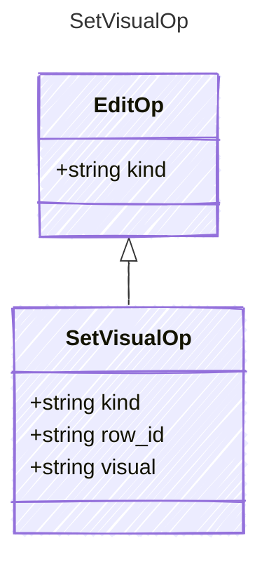

<!-- <auto-generated by typra-emitter> -->

Visual reference (`.cutready/visuals/<hash>.json`); null clears it.

## Class Diagram

## Properties

| Name | Type | Description |
| ---- | ---- | ----------- |
| kind | string |  |
| row_id | string |  |
| visual | string |  |
