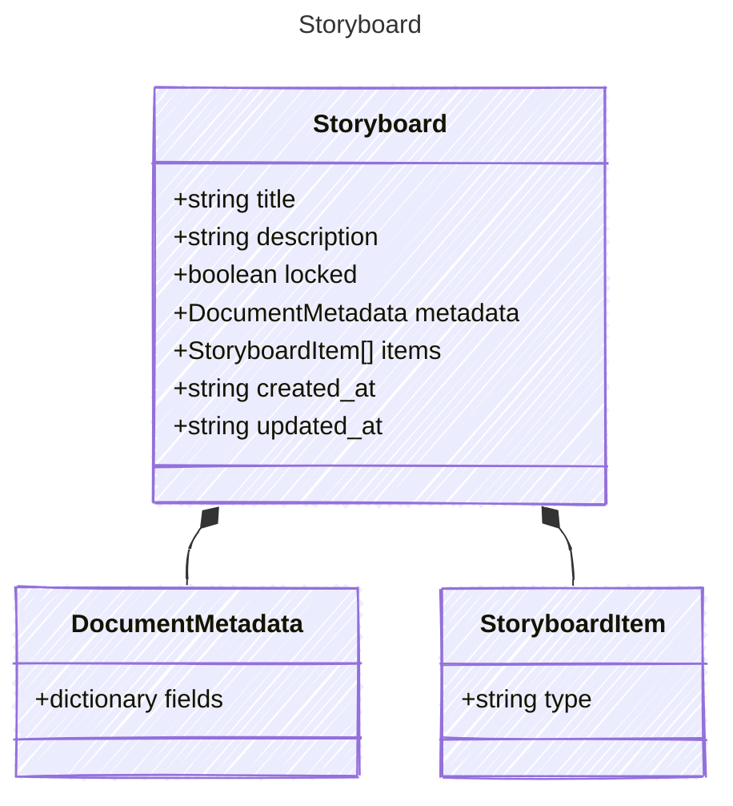

<!-- <auto-generated by typra-emitter> -->

A `.sb` file: an ordered sequence of sketches, optionally grouped into sections.
Sketches are referenced by project-relative path.
Legacy files list paths in a top-level `sketches` array instead of `items`;
runtimes read it as sketch references and never write it back.
Unknown top-level fields must survive every runtime's decode -> save.

## Class Diagram



## Yaml Example

```yaml
title: Launch demo
created_at: 2026-06-28T20:00:00Z
updated_at: 2026-06-28T20:20:00Z
```

## Properties

| Name | Type | Description |
| ---- | ---- | ----------- |
| title | string |  |
| description | string | Plain-text description. Saved as `""` when unset. |
| locked | boolean | Whether the whole storyboard is protected from edits. Saved as `false` when unset. |
| metadata | [DocumentMetadata](../documentmetadata/) |  |
| items | [StoryboardItem[]](../storyboarditem/) | (Related Types: [StoryboardSketchRef](../storyboardsketchref/), [StoryboardSection](../storyboardsection/)) |
| created_at | string | RFC 3339 UTC timestamp. Runtimes never rewrite a timestamp they did not change. |
| updated_at | string | RFC 3339 UTC timestamp, set by every successful edit. |

## Composed Types

The following types are composed within `Storyboard`:

- [DocumentMetadata](../documentmetadata/)
- [StoryboardItem](../storyboarditem/)
