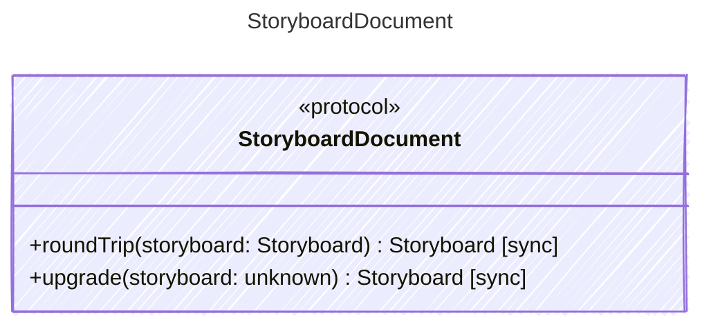

<!-- <auto-generated by typra-emitter> -->

Behavioral contract for `.sb` documents. Each runtime binds these operations
to its production decode and save code through a thin vector adapter.
Inputs and outputs are raw `.sb` JSON.

## Class Diagram

## Helper Methods

The following helper methods are declared via `@method` and must be implemented by every runtime. The schema declares the logical protocol contract; each runtime maps async-capable methods to idiomatic sync/async shapes for that language.

| Name | Signature | Runtime shape | Description |
| ---- | --------- | ------------- | ----------- |
| `roundTrip` | `roundTrip(storyboard: Storyboard) -> Storyboard` | sync | Decode a `.sb` document and save it again without changes. |
| `upgrade` | `upgrade(storyboard: unknown) -> Storyboard` | sync | Convert an older `.sb` shape to the canonical one. Runs on raw JSON before
decode, and is idempotent. Desktop saves the result back to disk.

- `items` missing or null: built from legacy `sketches` (else `[]`).
`sketches` is always dropped.
- Item type `sketch` becomes `sketch_ref`.
- Section: null or empty `description` is dropped; missing `sketches` is `[]`.
- Null or missing `description` is `""`; `locked` is `false`.
Null `metadata` is dropped. |
