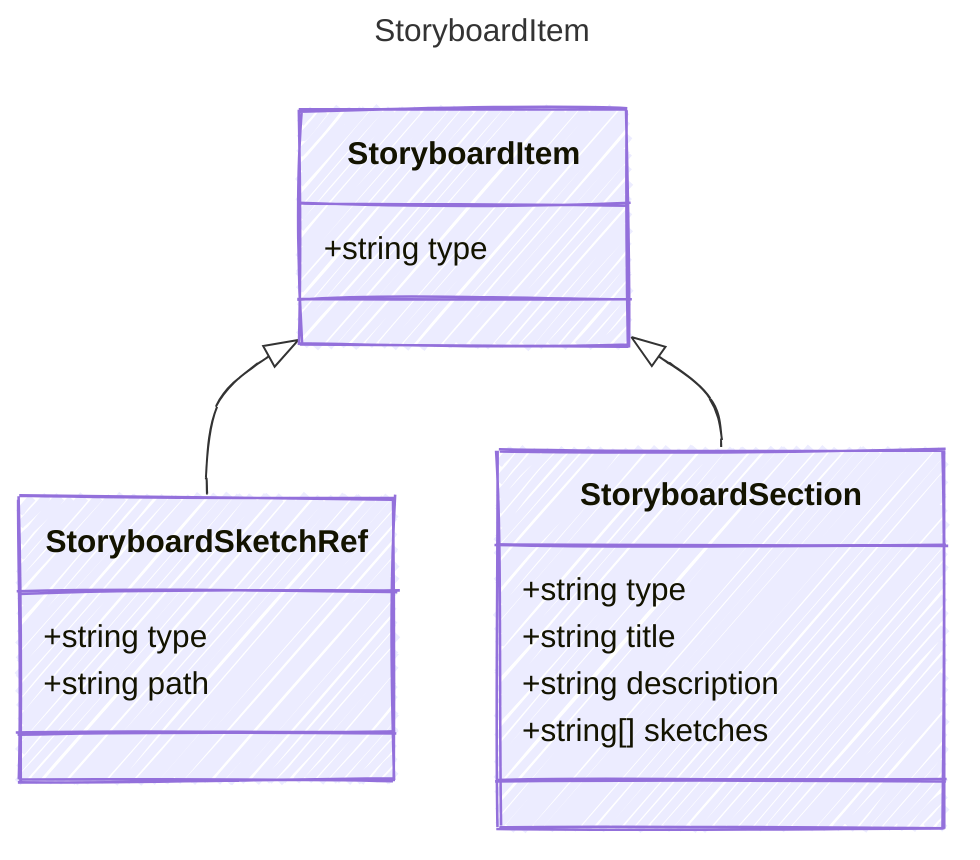

<!-- <auto-generated by typra-emitter> -->

One entry in a storyboard sequence.

## Class Diagram

## Properties

| Name | Type | Description |
| ---- | ---- | ----------- |
| type | string |  |

## Child Types

The following types extend `StoryboardItem`:

- [StoryboardSketchRef](../storyboardsketchref/)
- [StoryboardSection](../storyboardsection/)
