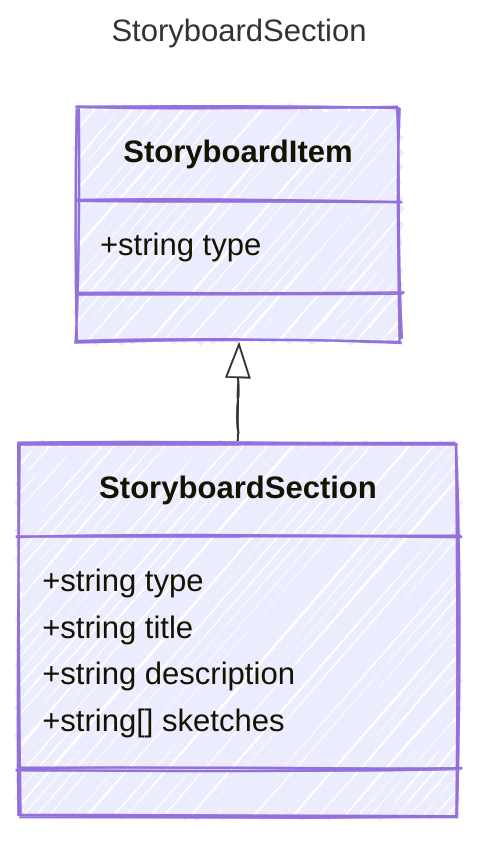

<!-- <auto-generated by typra-emitter> -->

A named group of sketches.

## Class Diagram



## Yaml Example

```yaml
title: Setup
```

## Properties

| Name | Type | Description |
| ---- | ---- | ----------- |
| type | string |  |
| title | string |  |
| description | string | Omitted when empty. |
| sketches | string[] | Project-relative sketch paths, in order. |
