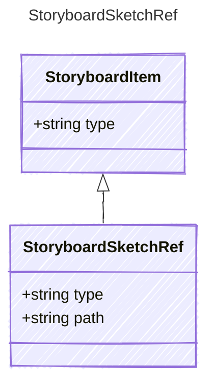

<!-- <auto-generated by typra-emitter> -->

A single sketch in the sequence.

## Class Diagram



## Yaml Example

```yaml
path: intro.sk
```

## Properties

| Name | Type | Description |
| ---- | ---- | ----------- |
| type | string |  |
| path | string |  |
