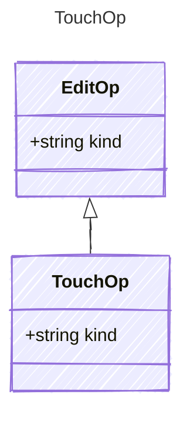

<!-- <auto-generated by typra-emitter> -->

Mark the document edited without changing anything else. On a storyboard it
follows the lock policy; on a sketch it doesn't, so a touch always succeeds.

## Class Diagram

## Properties

| Name | Type | Description |
| ---- | ---- | ----------- |
| kind | string |  |
