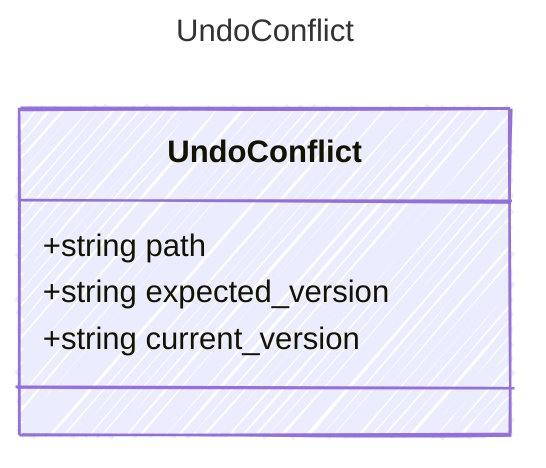

<!-- <auto-generated by typra-emitter> -->

One entity an undo can't revert. `path` addresses it: `""` for the whole
document (a note is only ever whole), `/<key>` for a top-level field,
`/rows/<id>` for a row's content, `/rows/<id>/locked` and
`/rows/<id>/locks` for its locks, and `/rows` for the order of row ids.
Versions are `documentVersion` of the file's bytes for `""` and of the
entity's compact JSON with keys sorted otherwise; absent entities omit them.

## Class Diagram

## Properties

| Name | Type | Description |
| ---- | ---- | ----------- |
| path | string |  |
| expected_version | string | The value the undo expected (the run's after value). |
| current_version | string | The value there now. |
