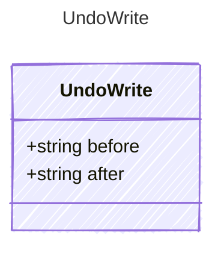

<!-- <auto-generated by typra-emitter> -->

One logged write: the document's bytes before and after (null when absent).

## Class Diagram

## Properties

| Name | Type | Description |
| ---- | ---- | ----------- |
| before | string |  |
| after | string |  |
