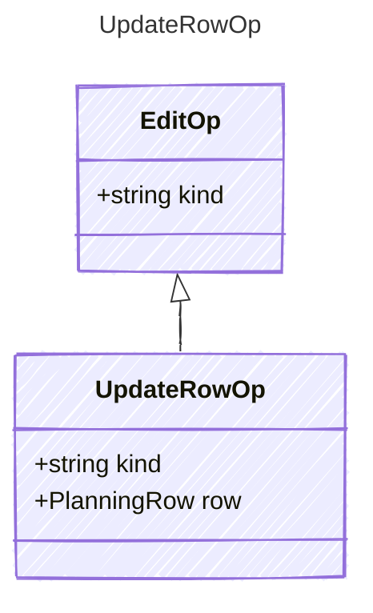

<!-- <auto-generated by typra-emitter> -->

Replace the row whose id is `row.id` with `row`, including fields this
runtime doesn't model. The row keeps its current lock state.

## Class Diagram

## Properties

| Name | Type | Description |
| ---- | ---- | ----------- |
| kind | string |  |
| row | [PlanningRow](../planningrow/) |  |
