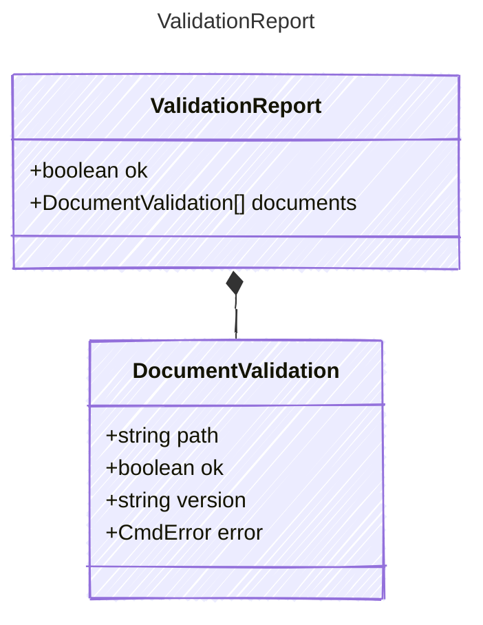

<!-- <auto-generated by typra-emitter> -->

`validate`: whether each document loads. `ok` is true when all of them do.

## Class Diagram

## Properties

| Name | Type | Description |
| ---- | ---- | ----------- |
| ok | boolean |  |
| documents | [DocumentValidation[]](../documentvalidation/) |  |

## Composed Types

The following types are composed within `ValidationReport`:

- [DocumentValidation](../documentvalidation/)
